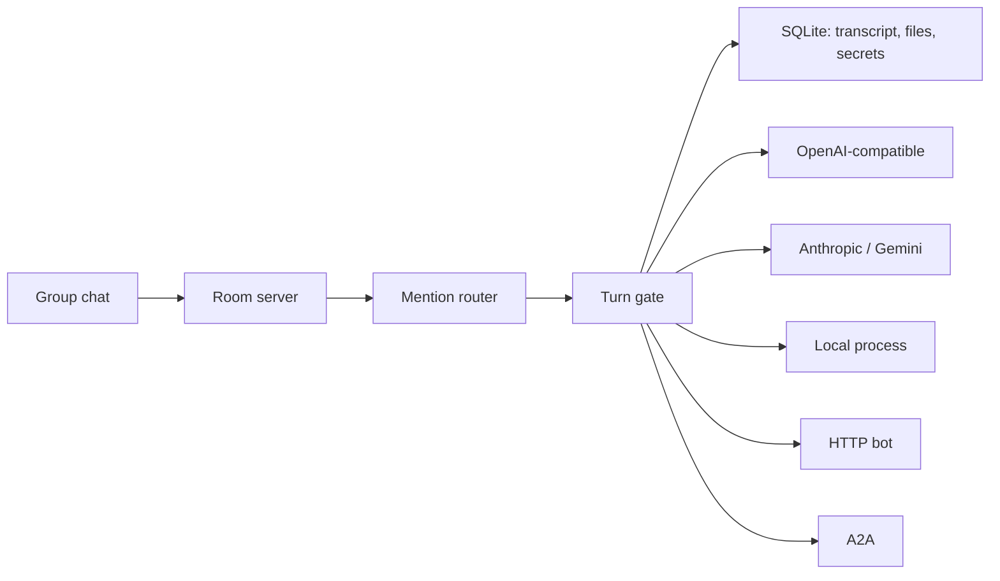
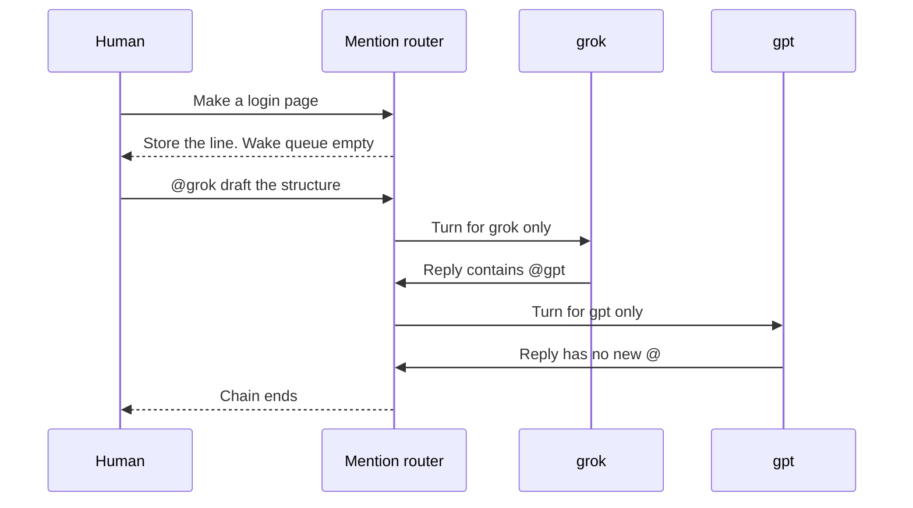

# Mention Workspace architecture

Status: partial demo. This document describes the browser demo that is in the repository now.  
Date: 2026-11-11.  
Scope: one machine, a group chat, mention-only turns, and adapter seams.

The later product is a [Kiro](https://kiro.dev) desktop app and phone app that stay linked and can be used together. That client is not this demo.

## 1. Goal

Show a shared room where people and agents talk, and an agent runs only when a message names it with `@handle`.

A human line with no mention is stored and wakes nobody. A human `@grok`, or grok's reply containing `@gpt`, is what starts the next call.

The demo must show that rule with at least two OpenAI-compatible endpoints that use different API keys and base URLs.

## 2. Out of scope for the demo

- Accounts, permissions, and org charts
- Billing, a rate-limit gateway, or a hundred-provider gateway
- Registering an MCP server itself as a room member
- Letting a model choose the next speaker
- A fixed role-play pipeline
- The Kiro desktop and phone clients

## 3. Decisions

The room service owns the mention rule. AutoGen, AgentScope, and LangGraph are not the runtime. Their default loops broadcast a message or pick a next speaker when nobody was named.

| Decision | Value |
| --- | --- |
| Interaction | Only `@handle` values parsed from the current message enter the wake queue |
| Several names | Allowed. Each named agent replies |
| `@all` | Not implemented. It is ignored and a system line is stored |
| Hop cap | At most 4 agent hops from the human message that started the chain |
| Repeat names | One queued wake per handle in a single message. A later message may name the same agent until hop 4 |
| Stack | TypeScript: Vite + React, Hono, SQLite, SSE |
| UI | A group chat, not a three-column workspace |
| License | MIT |

Two other shapes were considered and not used:

- AutoGen Studio or AgentScope Studio. The views exist, but the default meaning is broadcast and next-speaker selection.
- A task control plane with heartbeats. That fits a company simulation, not grok naming gpt in the same turn.

## 4. Reference projects

Public GitHub projects compared on 2026-11-11. Star counts are that day's snapshot. They describe community size, not a ranking.

| Project | Stars (snapshot) | Default collaboration | What this demo borrows |
| --- | ---: | --- | --- |
| [paperclipai/paperclip](https://github.com/paperclipai/paperclip) | 112,954 | Control plane. Heartbeats wake agents. One assignee per task. Adapters include Claude Code, Codex, a local process, and HTTP | Control plane separate from execution. Agent config stays on the server with the secret |
| [OpenHands/OpenHands](https://github.com/OpenHands/OpenHands) | 93,151 | A person hands work to a coding agent beside files, a terminal, and a browser | Earlier workspace reference. The demo UI is now a group chat |
| [bytedance/deer-flow](https://github.com/bytedance/deer-flow) | 85,226 | One lead agent plus sub-agents. External channels enter one runtime | Inbound and outbound traffic separated from adapters |
| [FoundationAgents/MetaGPT](https://github.com/FoundationAgents/MetaGPT) | 71,240 | Role scripts and a fixed flow | Role prompts and file handoff. The interaction model is not used |
| [BerriAI/litellm](https://github.com/BerriAI/litellm) | 63,067 | Multi-provider model gateway | Not used in the demo. A later gateway can replace the thin client if provider count or billing requires it |
| [microsoft/autogen](https://github.com/microsoft/autogen) | 61,778 | `SelectorGroupChat` picks the next speaker and broadcasts. Mention parsing exists, and the selector can still pick someone when nobody was named | Mention parsing must ignore code fences and thinking blocks |
| [crewAIInc/crewAI](https://github.com/crewAIInc/crewAI) | 60,743 | Role orchestration | Not in the runtime |
| [LibreChat-AI/LibreChat](https://github.com/LibreChat-AI/LibreChat) | 46,946 | Multi-model chat, keys, and presets | Connect form. Secrets are not returned to the browser |
| [agentscope-ai/agentscope](https://github.com/agentscope-ai/agentscope) | 35,750 | `MsgHub` broadcasts each reply to every participant | Run visualization idea. Broadcast is not used |
| [OpenBMB/ChatDev](https://github.com/OpenBMB/ChatDev) | 34,719 | Multi-role software conversation | Not in the runtime |
| [a2aproject/A2A](https://github.com/a2aproject/A2A) | 26,481 | Agent Card, `message/send`, streaming, long tasks | External agent socket |
| [microsoft/magentic-ui](https://github.com/microsoft/magentic-ui) | 10,113 | Human and agent sharing a browser and local files | Earlier side-panel reference |
| [LittleLittleCloud/Agent-ChatRoom](https://github.com/LittleLittleCloud/Agent-ChatRoom) | 84 | AutoGen agent chat room | Chat-room metaphor. The AutoGen runtime is not used |

No single project combined a shared room, wakeups that happen only on an explicit `@`, and API key / process / HTTP / A2A joins. The room service implements that itself.

## 5. Architecture

The browser talks only to the room server. Model keys, child processes, and external URLs stay on the server.



A valid wake:



| Module | Job |
| --- | --- |
| Group chat | Members, transcript, notes, files. `@` opens the member list |
| Room server | Store messages, push SSE, call the router |
| Mention router | Parse handles and build the wake list |
| Turn gate | Hop cap, duplicates, timeout, cancel. A failure stays on that agent |
| Adapter | Turn one request into a provider, process, or HTTP call |
| Store | Rooms, agents, messages, wakeups, artifacts, encrypted secrets |

## 6. Mention protocol

`grok@gpt` means the sender is grok and the body names `gpt`. In the chat, the author is grok and the body contains `@gpt`.

The server parses the body again. It does not trust a mentions field from the browser.

Handle rules:

- Unique in the room
- Stored in lowercase
- Charset `[a-z0-9_-]`, length 2 to 32
- `@GPT` and `@gpt` are the same agent

Only a body `@handle` counts. These do not wake anyone:

- An `@handle` inside a fenced code block
- A name inside `<thinking>...</thinking>`
- An unknown handle
- The sender naming their own handle

From a person:

- No valid handle: store the message and leave the wake queue empty. The chat adds a quiet line: "没有点名，没有人回复。"
- One or more valid handles: one wakeup per handle.

An agent reply uses the same parser, which continues the chain. Gate rules:

- Hops count from the human message that started the chain, up to 4. A mention after hop 4 is not run, and a system line is stored.
- A repeated handle in one message creates one queued wakeup.
- A later message in the chain may name the same agent again. Hop 4 still runs. Mentions it adds are skipped. That stops mutual `@` loops.
- `@human` does not call a model. The message is marked as waiting for the person. `@all` is not expanded, and a system line is stored.
- Timeout, 401, 429, or a process error is recorded on that agent only. The room does not hand the failure to someone else.

Context for a woken agent: the room goal, its own system prompt, the recent transcript with author names, and the message that named it. The prompt says to write `@handle` only when another member should continue. Shared history is read-only context. It does not call agents who were not named.

## 7. Adapters

```ts
interface AgentAdapter {
  kind: "openai_compat" | "anthropic" | "gemini" | "process" | "http" | "a2a" | "echo"
  probe(): Promise<"ok" | "unauthorized" | "unreachable">
  complete(turn: TurnRequest): AsyncIterable<string>
}
```

`TurnRequest` carries the agent config, the context that agent may read, the message that named it, and a cancel signal.

| Join | Config | Coverage |
| --- | --- | --- |
| OpenAI-compatible | base URL, API key, model, handle, system prompt | Grok / xAI, OpenAI, DeepSeek, Qwen-compatible endpoints, Ollama, vLLM, OpenRouter |
| Anthropic | API key, model, optional base URL | Claude |
| Gemini | API key, model, optional base URL | Google |
| Local process | command, arguments, working directory | CLIs such as Codex or Claude Code. Stdin is this turn's JSON. Stdout is the reply. The process is not started through a shell |
| HTTP | URL, optional bearer token | A custom bot. POST the context. The body is `{ "text": "..." }` |
| A2A | Agent Card URL, optional bearer token | An opaque external agent via discovery and `message/send` |
| MCP | server URL on an existing model agent | Tools for that agent. Not a room member |
| Echo | none | Local reply with no model call, so the mention rule can be tried without a key |

`probe()` runs before the agent is saved. A failed probe does not mark the agent idle and available.

Secrets are encrypted before they are written to SQLite. Read APIs return only "configured" and the last four characters of a fingerprint. Logs may include the handle, wakeup id, and status code. They do not include API keys, auth headers, or plaintext secrets.

The demo calls OpenAI-compatible chat completions directly. LiteLLM is not a dependency.

## 8. Interface

The demo UI is a group chat.

- Header: room switcher, new room, connect, echo pair, and member chips. A chip inserts `@handle`.
- Transcript: each line shows its author. `@handle` is highlighted. A line that named nobody gets a quiet system note. Only a woken agent streams.
- Notes: room goal and shared scratchpad, collapsed by default.
- Files: a reply fence that starts with ` ```file relative/path ` is stored and shown as an open button on that message. Paths cannot contain `..`.
- Composer: typing `@` opens the member list. Sending with no `@` is allowed and stays a note.

## 9. Data model

SQLite, one local file. Rows are scoped by `room_id`.

- `rooms`: id, name, goal, scratchpad, created_at
- `agents`: id, room_id, handle, display_name, adapter_kind, config_json (no plaintext secret), secret_id, system_prompt, runtime_status, created_at
- `secrets`: id, ciphertext, fingerprint
- `messages`: id, room_id, author_kind (`human`, `agent`, or `system`), author_id, author_handle, text, wait_human, created_at
- `wakeups`: id, room_id, chain_id, message_id, agent_id, handle, parent_wakeup_id, hop, status, reason, error, created_at, finished_at
- `artifacts`: id, room_id, message_id, path, content, created_at
- `settings`: active room id

`chain_id` is the human message that started the chain.

`status` is `queued`, `running`, `done`, `failed`, `cancelled`, or `skipped`. `skipped` covers the hop cap, a duplicate name, or a name that sat in an ignored region.

## 10. Errors and secrets

- One agent request times out after 60 seconds. That wakeup is `failed`.
- Stopping a streaming bubble aborts its `AbortSignal`. Text already produced is kept, and mentions inside a cancelled partial reply are not routed.
- Unparseable adapter output is stored as plain text and is not scanned for `@`.
- `.gitignore` ignores `.env`, `.data/`, and SQLite files so a local key store is not pushed.

## 11. Demo checks

Routing tests use fake adapters and do not need the network.

1. Send a line with no `@`. Both agents stay idle, and the transcript contains "没有点名".
2. Send `@grok ...`. Only grok streams.
3. grok's reply contains `@gpt`. Only gpt starts.
4. Send `@grok @gpt ...`. Both reply.
5. gpt writes `@grok` inside a code fence. grok is not woken.
6. Two fake adapters name each other. Execution stops on hop 4, with a system line.

## 12. What the demo includes now

- Mention router and hop gate
- Group chat and SSE
- Rooms
- OpenAI-compatible, Anthropic, Gemini, local process, HTTP, A2A, and echo joins
- MCP tools attached to a model agent
- File fences and encrypted local secrets

These are demo implementations. They are deep enough to exercise the rule, not a finished desktop or phone client.

## 13. After this demo

Build the linked product in Kiro:

- A desktop app and a phone app
- The same room on both, usable together without this browser demo as the client
- The mention rule and adapter boundary stay. The chat shell in this repository does not

## 14. Demo conventions

- Reserved handles: `human`, `all`, `system`, `me`. Hand work back to the person with `@human`.
- The room server defaults to `127.0.0.1:8787`. The Vite dev server defaults to `127.0.0.1:5173` and proxies `/api`.
- Secrets use AES-256-GCM with `.data/master.key`. `.data/` is not in git.
- A local process is spawned without a shell. Arguments are split on whitespace and quotes.
- Mentions wake agents only in the active room.
