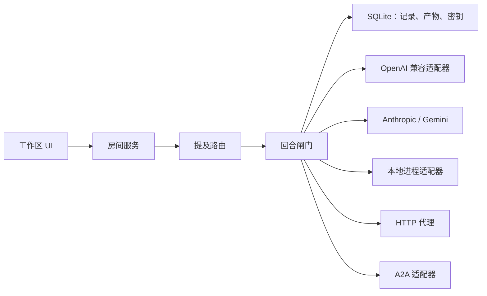
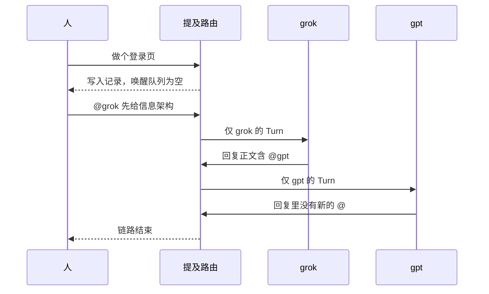

# Mention Workspace 技术方案

状态：已定稿，作为第一版实现依据。  
日期：2026-11-11。  
范围：单机、单房间的可演示工作区。代码尚未开始。

## 1. 目标

做一个多 agent 协同 demo，让不同来源的 agent 接入同一块工作区，并只通过显式 `@` 互相触发。

工作区同时给人使用。人写下的一句话如果没有点名，任何 agent 都不会回复。人 `@` 某一个 agent，或某个 agent 在回复里 `@` 另一个 agent，才产生下一次调用。

第一版要能当场演示这条规则，并至少接入两个使用不同 API Key、不同 baseURL 的 OpenAI 兼容模型，例如 grok 和 gpt。

## 2. 非目标

第一版不做这些事：

- 多用户账号、权限和组织架构
- 多房间
- 计费后台、限流网关、一百多家模型厂商的统一适配
- 把 MCP 服务本身注册成房间成员
- 用大模型自动挑选下一位发言者
- 固定剧本式的软件公司流水线

## 3. 已定决策

采用自建的点名房间，不把 AutoGen、AgentScope 或 LangGraph 放进运行时。那些框架的默认循环会广播消息，或在无人被点名时继续选出下一位发言者。本项目的不变量需要由房间服务直接保证。

已锁定的默认值：

| 决策 | 取值 |
| --- | --- |
| 交互模型 | 只有本条消息解析出的 `@handle` 进入唤醒队列 |
| 多人点名 | 允许。点到谁，谁回复 |
| `@all` | 不实现。出现时忽略，并记一条系统说明 |
| 链路跳数 | 同一条人类发言带出的 agent 链路最多 4 跳 |
| 重复唤醒 | 同一条链上，同一个 agent 只被叫醒一次，除非之后有一条新消息再次点名 |
| 技术栈 | TypeScript：Vite + React 前端，Hono 房间服务，SQLite，SSE |
| 第一版接入 | OpenAI 兼容 API Key |
| 许可证 | MIT |

备选过另外两条路，不采用：

- 改 AutoGen Studio 或 AgentScope Studio。可视化现成，但默认语义是广播和选择下一位，和点名规则对着干。
- 做成任务控制面，用心跳领工单。适合公司模拟，不适合 `grok` 的回复当场点名 `gpt`。

## 4. 参考项目

2026-11-11 在 GitHub 上对照过的公开项目。星标是当天快照，只说明社区规模，不作为选型排序。

| 项目 | 星标（快照） | 默认协作方式 | 本方案借用的部分 |
| --- | ---: | --- | --- |
| [paperclipai/paperclip](https://github.com/paperclipai/paperclip) | 112,954 | 控制面。心跳叫醒 agent，任务单人认领。适配器包括 Claude Code、Codex、本地进程、HTTP | 控制面与执行面分离；Agent 配置卡；密钥留在服务端 |
| [OpenHands/OpenHands](https://github.com/OpenHands/OpenHands) | 93,151 | 人把任务交给编码代理，旁边是文件、终端和浏览器 | 三栏工作区 |
| [bytedance/deer-flow](https://github.com/bytedance/deer-flow) | 85,226 | 一个主代理加子代理，外部频道进入同一个运行时 | 入站、出站和适配器解耦的消息总线 |
| [FoundationAgents/MetaGPT](https://github.com/FoundationAgents/MetaGPT) | 71,240 | 角色剧本和固定流程 | 角色提示词、产物交接。交互模型不采用 |
| [BerriAI/litellm](https://github.com/BerriAI/litellm) | 63,067 | 多厂商模型网关 | 厂商变多以后再考虑替换兼容层。第一版不引入 |
| [microsoft/autogen](https://github.com/microsoft/autogen) | 61,778 | `SelectorGroupChat` 每轮选出下一位，并向全体广播。内部有提及解析，选择器仍会在无人被点名时指定发言人 | 只借鉴提及解析要避开代码块和思考块 |
| [crewAIInc/crewAI](https://github.com/crewAIInc/crewAI) | 60,743 | 角色编排 | 不进入运行时 |
| [LibreChat-AI/LibreChat](https://github.com/LibreChat-AI/LibreChat) | 46,946 | 多模型聊天、密钥和预设 | 接入表单和密钥不回传前端 |
| [agentscope-ai/agentscope](https://github.com/agentscope-ai/agentscope) | 35,750 | `MsgHub` 把回复广播给房间内所有参与者 | Studio 的运行可视化思路。广播语义不采用 |
| [OpenBMB/ChatDev](https://github.com/OpenBMB/ChatDev) | 34,719 | 多角色软件开发对话 | 不进入运行时 |
| [a2aproject/A2A](https://github.com/a2aproject/A2A) | 26,481 | Agent Card、`message/send`、流式和长任务 | 第三阶段的外部 agent 插座 |
| [microsoft/magentic-ui](https://github.com/microsoft/magentic-ui) | 10,113 | 人机协同的浏览器与本地文件 | 工作区侧栏的参考 |
| [LittleLittleCloud/Agent-ChatRoom](https://github.com/LittleLittleCloud/Agent-ChatRoom) | 84 | AutoGen 代理聊天室 | 界面隐喻接近。运行时不采用 |

没有一个现成项目同时满足三件事：工作区形态、只有显式 `@` 才唤醒、以及 API Key / 进程 / HTTP / A2A 多种接入。所以房间服务自己实现。

## 5. 架构

浏览器只连接房间服务。模型密钥、子进程和外部 URL 都留在服务端。



一次合法唤醒的顺序：



模块职责：

| 模块 | 职责 |
| --- | --- |
| 工作区 UI | 成员、记录、共享备忘、产物、本轮链路。输入 `@` 时弹出成员 |
| 房间服务 | 保存消息，向前端推送 SSE，调用路由 |
| 提及路由 | 从正文解析 handle，生成唤醒名单 |
| 回合闸门 | 执行跳数、去重、超时和取消。失败停在该 agent |
| 适配器 | 把一次 Turn 变成具体厂商、进程或 HTTP 调用 |
| 存储 | 房间、agent、消息、wakeup、产物、加密后的密钥 |

## 6. 提及协议

`grok@gpt` 在本项目里的意思是：发送者是 grok，正文里点名了 `gpt`。界面上的写法是消息作者为 grok，正文包含 `@gpt`。

服务端重新解析正文，不信任前端附带的 mentions 字段。

Handle 规则：

- 房间内唯一
- 规范化为小写
- 字符集为 `[a-z0-9_-]`，长度 2 到 32
- `@GPT` 与 `@gpt` 指向同一个 agent

算作点名的，只有正文里的 `@handle`。下面这些不产生唤醒：

- 围栏代码块中的 `@handle`
- `<thinking>...</thinking>` 中出现的名字
- 未知 handle
- 发送者点自己的 handle

人发来的消息：

- 零个有效 handle：保存消息，唤醒队列为空。界面记一条淡色说明：「没有点名，没有 agent 被叫醒。」
- 一个或多个有效 handle：为每个 handle 建立一个 wakeup。

agent 发来的回复走同一套解析。由此形成链路。闸门规则：

- 跳数从触发这条链的人类消息算起，最多 4。第 4 跳之后新的 `@` 不再执行，并留下系统记录。
- 同一条链上，同一个 agent 只执行一次。之后若有一条新的人类消息再次点名，可以再次执行。
- agent `@` 人时不调用模型。该消息在工作区标为「等你」。
- 适配器超时、401、429 或进程异常只标记在该 agent 上。房间服务不把这次失败转给其他 agent。

上下文：

被叫醒的 agent 收到房间目标、自己的系统提示、带作者名的最近记录，以及点名它的那条消息。提示词要求：需要别人继续时在回复里写 `@handle`；不需要就不要写 `@`。共享记录是只读上下文，不会使未被点名的 agent 被调用。

## 7. 适配器

```ts
interface AgentAdapter {
  kind: "openai_compat" | "anthropic" | "gemini" | "process" | "http" | "a2a"
  probe(): Promise<"ok" | "unauthorized" | "unreachable">
  complete(turn: TurnRequest): AsyncIterable<TurnEvent>
}
```

`TurnRequest` 包含该 agent 的配置引用、允许它阅读的上下文、点名它的消息，以及取消信号。`TurnEvent` 至少覆盖增量文本、结束和错误。

| 接入 | 阶段 | 配置 | 覆盖范围 |
| --- | --- | --- | --- |
| OpenAI 兼容 | 第一版 | baseURL、apiKey、model、handle、系统提示 | Grok / xAI、OpenAI、DeepSeek、通义兼容接口、Ollama、vLLM、OpenRouter |
| Anthropic | 第一版之后 | apiKey、model | Claude。消息格式与 OpenAI 兼容接口不同 |
| Gemini | 第一版之后 | apiKey、model | Google |
| 本地进程 | 第二阶段 | 命令、参数、工作目录 | Codex、Claude Code 等 CLI。标准输入为本轮 JSON，标准输出为回复文本 |
| HTTP | 第二阶段 | URL、认证头 | 自建 bot。POST 上下文，响应体为 `{ "text": "..." }` |
| A2A | 第三阶段 | Agent Card URL | 外部不透明 agent。使用发现和 `message/send` |
| MCP | 工具，不是成员 | server URL | 挂到某一个已经接入的 agent 上 |

保存 agent 前先调用 `probe()`。探针失败时不把该 agent 标为空闲可用。

密钥写入 SQLite 前加密。读取接口只返回「已配置」和指纹后四位。进程环境里可以注入解密后的密钥，响应和日志里不打印密钥。

第一版直接请求 OpenAI 兼容的 chat completions，不引入 LiteLLM。厂商数量、计费和限流成为实际问题时，再把这一层换成 LiteLLM。

## 8. 界面

三栏，按工作区而不是单栏聊天来排。

- 左栏成员：handle、厂商标记、状态（空闲、生成中、失败）。「接入」打开对应适配器表单。
- 中栏记录：每条消息显示作者。`@handle` 渲染成名字。未被点名的发送显示淡色系统记录。只有进入唤醒队列的卡片出现流式输出。
- 右栏：共享备忘、产物、本轮链路。备忘是全体可读的短文档。产物来自回复中显式交出的文件。链路显示谁点了谁，以及当前跳数。
- 输入框：输入 `@` 弹出当前成员。没有 `@` 也允许发送，结果是一条工作区笔记。占位文案说明这一点。

第一版右栏先做共享备忘和本轮链路。产物栏放到第二阶段，数据模型第一版就留出位置。

## 9. 数据模型

SQLite，单机文件。第一版一张房间记录即可，表结构仍按 `room_id` 隔离，避免以后加房间时改主键。

- `rooms`：id、name、goal、created_at
- `agents`：id、room_id、handle、display_name、adapter_kind、config_json（不含密钥明文）、secret_id、system_prompt、created_at
- `secrets`：id、ciphertext、fingerprint
- `messages`：id、room_id、author_kind（human 或 agent）、author_id、text、created_at
- `wakeups`：id、room_id、chain_id、message_id、agent_id、parent_wakeup_id、hop、status、error、created_at、finished_at
- `artifacts`：id、room_id、message_id、path、content、created_at

`chain_id` 指向触发这条链路的人类消息。跳数和「同一条链只叫醒一次」都按它计算。

`status` 取 `queued`、`running`、`done`、`failed`、`cancelled`、`skipped`。`skipped` 用于超过跳数、重复点名，或点名落在被忽略的位置。

## 10. 错误处理与安全

- 单个 agent 的请求超时默认 60 秒。超时后把该 wakeup 标为 `failed`，前端停在这张卡片。
- 用户停止某张正在生成的卡片时，取消对应的 `AbortSignal`。已写出的文本保留。
- 适配器返回无法解析的内容时，按纯文本保存，不再从这段原文里解析 `@`。
- 日志可以记录 handle、wakeup id 和状态码，不记录 apiKey、认证头和密钥明文。
- `.gitignore` 忽略 `.env` 和 SQLite 文件，避免把本地密钥库推进仓库。

## 11. 第一版验收

房间里配置 `grok` 和 `gpt` 两个 OpenAI 兼容 agent，apiKey 与 baseURL 可以不同。路由测试使用假适配器，不依赖外网。

1. 发送「做个登录页」。两条 agent 都保持空闲，记录中出现「没有点名」。
2. 发送「@grok 先给信息架构」。只有 grok 流式输出。
3. grok 的回复正文包含 `@gpt`。只有 gpt 启动。
4. 发送「@grok @gpt 各给一个标题」。两个都回复。
5. gpt 在围栏代码块里写入 `@grok`。grok 不被叫醒。
6. 让两个假适配器互相 `@`。执行停在第 4 跳，并留下系统记录。

## 12. 分期

第一版：

- 一个房间，本机运行
- 成员栏、记录、共享备忘、链路
- OpenAI 兼容接入和 `probe()`
- 第 6 节的路由与闸门
- 第 11 节的验收

第二阶段：

- 产物栏
- Anthropic 与 Gemini
- 本地进程适配器
- HTTP 适配器

第三阶段：

- A2A Agent Card 接入
- 按 agent 挂载 MCP 工具
- 多房间

## 13. 仓库与实现顺序

文档先行。实现开始时按下面的顺序落代码，每一步都能用第 11 节里的假适配器验证，再接真实 API Key：

1. 提及解析与闸门的单元测试
2. SQLite 表和房间服务
3. OpenAI 兼容适配器
4. 三栏界面与 SSE
5. 用两个真实兼容端点走通验收第 2、3、4 步
